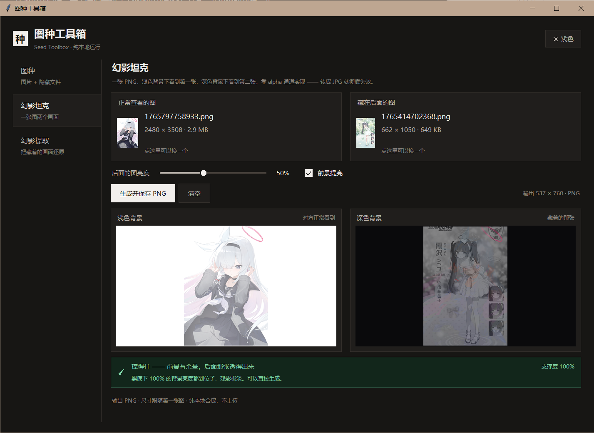
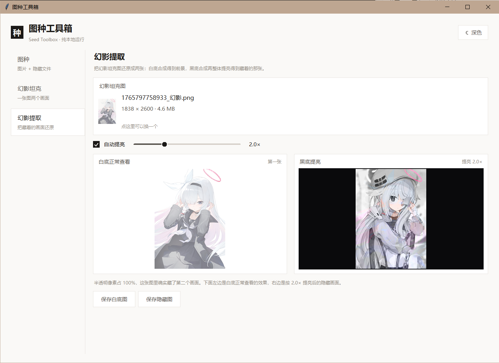
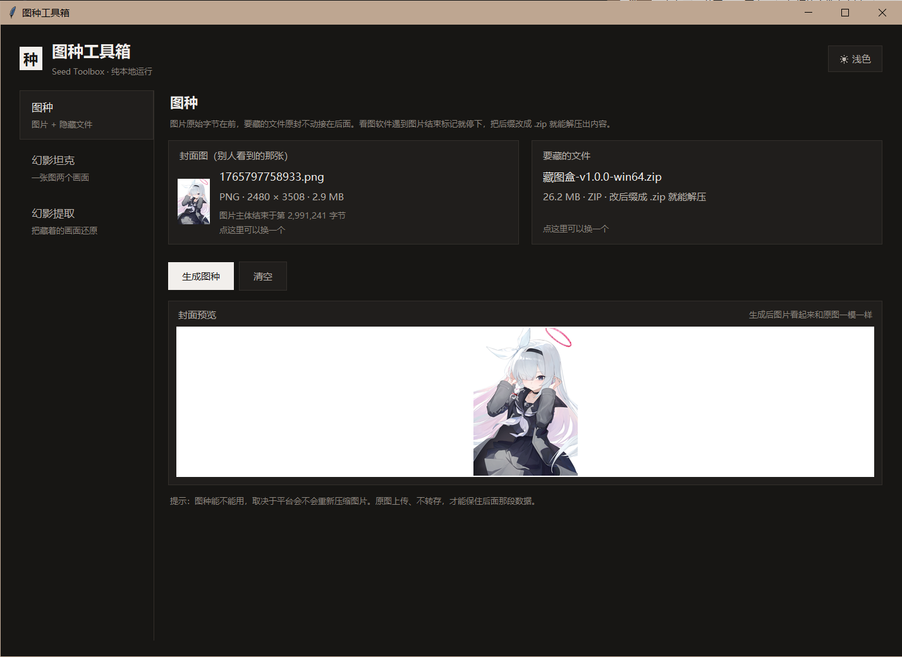
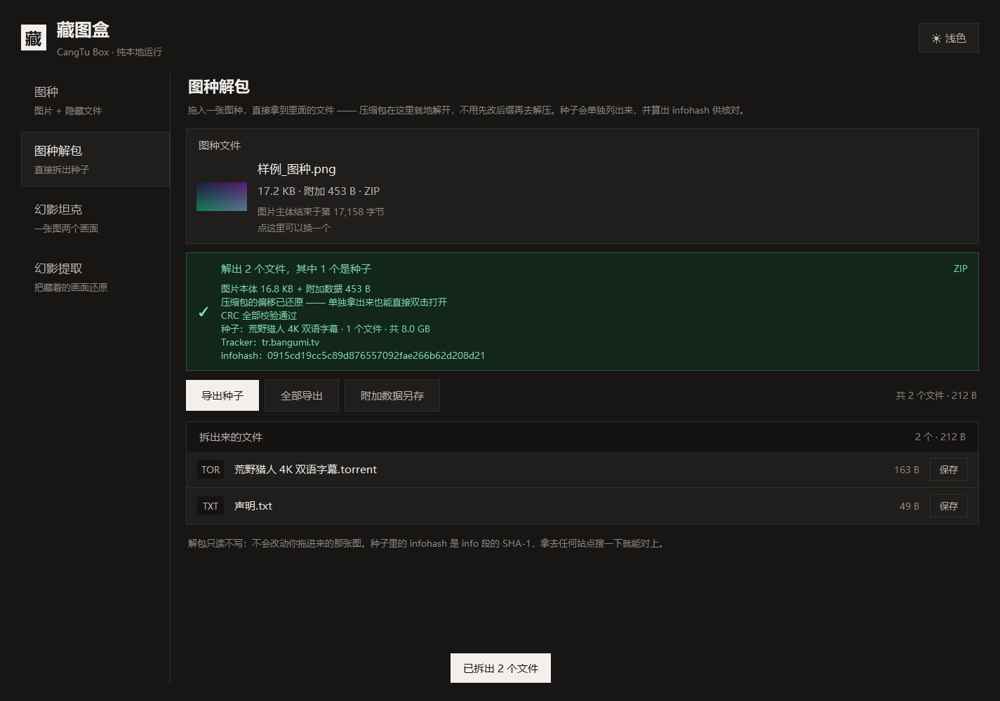

# 藏图盒 · CangTu Box

> 把文件藏进图片，一张 PNG 装两个画面。
> 绿色免安装，纯本地运行，不联网、不上传。

Windows 10 / 11 (x64) · Python 3.10+ · MIT License



---

## 下载

**[⬇ 下载最新版](../../releases/latest)**

1. 下载 `藏图盒-vX.X.X-win64.zip`
2. 解压到**任意可写目录**（别放 `C:\Program Files`，那里写不了配置和日志）
3. 双击 `藏图盒.exe`

不需要装 Python，不需要联网，不需要管理员权限。整个目录可以拷到 U 盘里带走。

> **首次运行会被 Windows SmartScreen 拦一下**
>
> 弹窗写「Windows 已保护你的电脑」——因为程序没有购买代码签名证书（一年几千块）。
> 点「更多信息」→「仍要运行」即可，只需要一次。
>
> 部分杀毒软件也会误报。PyInstaller 打包的 Python 程序是误报重灾区，
> 加信任或添加白名单就行。所有源码都在这个仓库里，可以自己审。

---

## 四个功能

### 1. 幻影坦克 —— 一张图，两个画面

浅色背景下看到一张，深色背景下看到另一张。靠 alpha 通道合成，不是障眼法。

拖入两张图，**自动出双底色预览** —— 左右并排就是你分别在白底和黑底上会看到的效果，
不用先保存再打开验证。下面那条诊断会直接告诉你「撑得住 93%」还是「撑不住，换前景图」。

原理（每个像素独立算）：

```
a = 1 − d/255          d = 前景亮度 − 背景亮度 × k   （夹到 [0, 最小通道值]）
RGB = (P − d) / a
```

铺在白底上：`RGB×a + 255×(1−a) = P` → 精确还原前景
铺在黑底上：`RGB×a = P − d` → 看到被压暗的背景

所以「后面那张一定更暗」不是取舍，是公式决定的。

### 2. 幻影提取 —— 把藏着的画面还原



把幻影坦克图拖进来，白底 / 黑底各合成一遍，两张画面分开。

自动提亮用图像 p99 亮度去凑 248，反推生成时压暗的倍数 —— 比按平均亮度猜稳，
暗调背景不会被整体拉爆。也可以手动拖滑块。

深色底那张在生成时亮度就被 alpha 压掉了，**不可能完全还原**，所以提亮做成可调的，
不给「完美还原」这种假承诺。

### 3. 图种 —— 把文件藏进图片



图片在前，压缩包原封不动接在后面。看图软件读到图片结束标记就停，后面的数据被忽略；
把后缀改成 `.zip`，解压软件就能读到它。

**载荷必须是 `.zip`。** RAR / 7z / 视频 / exe 都不行 ——
它们的签名必须落在文件第 0 字节，接在图片后面就永远找不到。
工具会识别载荷类型，不是 zip 会直接标红提醒。

### 4. 图种解包 —— 把藏的东西拿回来



反向做一遍，而且**不用改后缀、不用解压**：拖进图种 → 图片结尾之后那段就是载荷
→ 是压缩包就在内存里解开 → 里面的文件直接列出来，一键导出种子。

只读不写，不动你拖进来的原图。三种判断依据一起给：

- **CRC32 逐文件校验**：对不上说明图种在传输中被截断/改坏了，会标红文件名，并尽量把内容救出来
- **种子概要**：名称、文件数、总大小、Tracker
- **infohash**：`info` 段的 SHA-1，种子的唯一身份，拿去任何站点搜一下能对上就是原种

改了后缀的图片照样认，直接拖 `.torrent` / `.zip` 也能用。

---

## 一个别人没做的细节：ZIP 偏移修正

自己实现图种时，最容易踩的坑在这里。

ZIP 末尾有一条 EOCD 记录，写着「中央目录在文件开头往后第 N 字节」；
每个条目里又写着「我的本地头在第几个字节」。这些数字都是**相对 zip 数据自身起点**的。

把 zip 接在图片后面，图片那 20 万字节把一切都推后了，记录里的数字就全错位：

```
                     记录的位置   实际位置     结果
纯 zip                    262        262        ✅
图片 + zip（未修正）       262     216651        ❌ 偏差 = 图片长度
图片 + zip（已修正）    216651     216651        ✅
```

有意思的是**不同解压器的宽容度天差地别**：

| 解压器 | 遇到偏移不符 | 结果 |
|---|---|---|
| python `zipfile` | 自动算差值补偿 | ✅ 能读 |
| bsdtar / .NET | 同上 | ✅ 能读 |
| **7-Zip / Bandizip** | 不补偿，直接去记录的位置找签名 | ❌ 报「不是压缩文件」 |

于是就出现了那种割裂现象：工具自己能拆，解压软件却说损坏。
**「能不能打开」不取决于你，取决于对方用什么软件。**

本工具在写入前把每个条目的偏移量加上图片长度、EOCD 偏移写成绝对位置
（等价于 Info-ZIP 的 `zip -A`），拆分时再减回去。改完之后文件仍是合法 zip，
所有解压器口径一致，不再依赖谁的宽容度。

「图种解包」认两种状态：偏差为 0 的直接读；偏差为「负的图片长度」说明是修正过的，
先还原偏移再读，所以本工具生成的图种和别人生成的图种都能拆，
导出的 `.zip` 也是干净可双击的。

代码在 [`core/zipfix.py`](core/zipfix.py)，约 170 行，带完整注释。

---

## 从源码运行

```bash
git clone https://gitee.com/BDSMT/treasure-picture-box.git
cd cangtu-box
pip install -r requirements.txt
python 藏图盒.py
```

需要 Python 3.10+（自带 tkinter 的完整发行版，不要用精简版）。

源码运行时会优先读 `vendor/` 目录，没有就退回 site-packages，两种方式都行。

---

## 自行构建

```bash
pip install -r requirements-dev.txt
python build.py
```

产物在 `release/藏图盒-vX.X.X-win64.zip`，解压即用。

`build.py` 会依次做：装依赖到 `vendor/` → PyInstaller 打包（onedir）→
拷入说明和许可证 → 打 zip。用 onedir 而不是 onefile，是因为 onefile
每次启动要把 65 MB 解压到临时目录，冷启动慢 2~3 秒。

---

## 常见问题

**Q：双击没反应 / 闪一下就没了？**

在命令行里跑 `藏图盒.exe --selftest`，它会把各项能力逐项检查写进 `logs\selftest.log`
（Python 版本、DPI、拖放、合成、图种往返）。崩溃详情在 `logs\error.log`。

**Q：改完后缀，解压软件说文件损坏？**

按顺序排查：

1. **载荷不是 zip** —— 看载荷卡片有没有橙色提示。先压成 `.zip` 再当载荷。
2. **后缀没真改掉** —— Windows 默认隐藏扩展名，`xx.jpg` 改成 `xx.zip` 可能变成 `xx.zip.jpg`。
   资源管理器 →「查看」→ 勾上「文件扩展名」再确认。
3. **改成了 `.rar` 或 `.7z`** —— 载荷是 zip 就必须改成 `.zip`，解压软件按后缀选解析器。
4. **用旧版本生成的** —— 早期版本没做偏移修正，7-Zip 会拒绝。用新版重新生成。

**Q：图种传上去就打不开了？**

平台重新压缩了图片（微信、贴吧、大部分图床都会）。这是图种这种做法的固有弱点。
原图上传、不转存才有效，或者用网盘直传。

**Q：为什么幻影坦克必须存 PNG？**

JPEG 没有 alpha 通道。转成 JPG 就彻底失效，两张图都变糊。

**Q：支持 macOS / Linux 吗？**

代码本身是跨平台的（Python + tkinter + Pillow），但拖放组件 tkinterdnd2 和
打包配置只针对 Windows 调过。想在别的系统上跑，需要自己处理 tkdnd 的二进制。

**Q：数据会上传吗？**

不会。全程序没有任何网络调用，可以断网运行验证。

---

## 项目结构

```
cangtu-box/
├─ 藏图盒.py        启动入口（DPI 感知、异常兜底、自检）
├─ core/
│  ├─ sniff.py          图片格式识别，算出「真正的结尾」在第几字节
│  ├─ seed.py           图种的打包与拆分
│  ├─ unpack.py         图种解包：ZIP 就地解压 + bencode 种子解析 + infohash
│  ├─ zipfix.py         ZIP 偏移修正 / 还原
│  ├─ phantom.py        幻影坦克合成 + 支撑度统计
│  ├─ reveal.py         幻影提取
│  ├─ imageio.py        图像解码、铺满、缩放
│  └─ paths.py          配置与日志路径
├─ ui/
│  ├─ app.py            主窗口与四个模块
│  ├─ widgets.py        自绘控件（滑块、复选框、拖放卡片、双底色预览）
│  └─ theme.py          明暗两套配色 + DPI 缩放
├─ tools/               开发期诊断脚本（不参与打包）
├─ docs/                README 用图
├─ build.py             一键构建
└─ 藏图盒.spec       PyInstaller 配置
```

---

## 许可证

[MIT](LICENSE)。随便用，包括商用。改完不用告诉我，但出了问题别找我。

幻影坦克的算法来自网络上的公开实现，这个版本的 Python 实现和界面是重写的。
